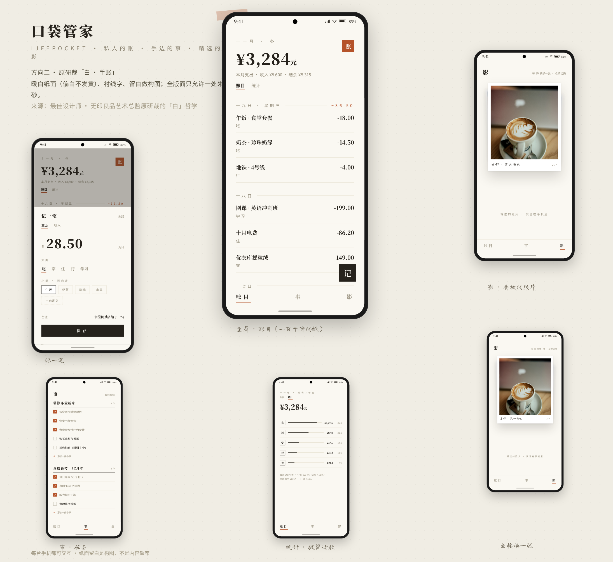

# 口袋管家 LifePocket

> 私密记账 · 任务待办 · 胶片相册 —— 一个装在自己手机上的小而美 App。**数据 100% 只存在你的手机里。**



## 这是什么

一个安卓个人工具 App，三个模块：

| 模块 | 功能 |
|---|---|
| **账目** | 记一笔（大类 → 小类 → 备注），大类预置「吃/穿/住/行/学习」可自定义；小类完全自定义（午饭、奶茶……），月度明细按天分组，自动汇总收支 |
| **统计** | 本月各大类支出占比条、最常记的小类、平均每天花多少、和上月对比 |
| **事** | 按任务分组管理待办：一个任务（如「装修布置新家」）下面挂若干子项，勾选即算进度，任务卡显示 x/y 与进度条 |
| **影** | 从相册精选若干照片，App 内以「上层一张清晰 + 下层两张偏移虚化」的胶片质感叠放展示，定时轮换（30秒/1分/5分/手动），点按切换 |

## 隐私：数据只在你手机上

这不是一句口号，是可以验证的事实：

- **AndroidManifest 不申请任何网络权限**（没有 `INTERNET` 权限的 App 在系统层面无法发出网络请求）
- 账目、任务、照片记录全部存在本机 SQLite（Room），照片只保存系统相册返回的 URI，不复制原图
- 选照片用的是系统选图器（SAF），**不需要申请相册/存储权限**
- 支持一键导出 CSV 备份（你指定保存位置），随时带走自己的数据

## 设计

UI 采用「**白 · 手账**」方向：暖白纸面（偏白不发黄）、衬线字、墨色正文、全版面只允许一处朱砂色强调。设计过程遵循 huashu-design 工作流：三个方向的高保真原型（[原生精修](design-demos/dir-1.html) / [白·手账（选定）](design-demos/dir-2.html) / [友好金融](design-demos/dir-3.html)）+ 六候选缩略图 + 方向卡与选定记录，全部在 [`design-demos/`](design-demos/) 里可回溯。

## 技术栈

- Kotlin 2.0 + Jetpack Compose (Material 3)
- Room 2.6（SQLite 持久化）+ KSP
- Navigation Compose / Lifecycle / Coil
- minSdk 26（Android 8.0+）/ targetSdk 35
- APK 约 10~15MB（R8 优化后）

## 自己构建

需要 JDK 17 和 Android SDK（含 platform 35）。

```bash
# 单元测试（金额格式化 / CSV 转义 / 月份区间）
sh gradlew :app:testDebugUnitTest

# 编译可安装的 release APK（用 debug 签名，方便直接安装；正式发布请替换为自己的签名）
sh gradlew :app:assembleRelease
# 产物：app/build/outputs/apk/release/app-release.apk
```

或直接下载仓库里的 `LifePocket-release.apk` 传到手机安装（需允许「安装未知应用」）。

## 路线图（ ideas ）

- [ ] 应用锁（PIN / 指纹），进一步保护「私密」
- [ ] 月度预算罐子（Monzo 式，dir-3 备选方向的遗产）
- [ ] 桌面小组件：胶片相册叠放widget
- [ ] 深色模式（墨色纸面）
- [ ] iOS / 桌面端（Kotlin Multiplatform）

## 致谢

设计参考与灵感来自这些优秀的开源项目：[BeeCount 蜜蜂记账](https://github.com/TNT-Likely/BeeCount)、[Veri Fin](https://github.com/LumiDesk/verifin)、[OneLedger](https://github.com/Sirens007/OneLedger-Android)、[Taskfern](https://github.com/riyadmondol2006/Taskfern)、[Tasks.org](https://tasks.org)。设计原型由 [huashu-design](https://github.com/alchaincyf/huashu-design) 工作流产出。

## License

[MIT](LICENSE)
